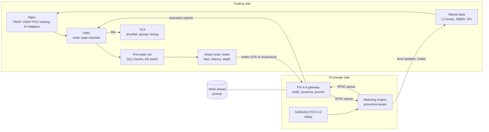

# Execution Engine

A trading stack in C++20, from the matching engine up to execution algorithms. The system:

- matches orders;
- tracks every order's state and checks risk before anything is sent;
- replays real NASDAQ market data;
- works large orders with execution algorithms;
- routes them across venues;
- speaks FIX over TCP;
- survives a crash.

It is built and measured stage by stage. Every number in this README was measured on this
code, and [BENCHMARKS.md](BENCHMARKS.md) shows how.

The stack is deliberately small: C++20, CMake and POSIX sockets, with no third-party
libraries. The tests use `assert` and research runs in Python (pandas and matplotlib) over CSV
output.

## Architecture



The two sides share no memory. They exchange messages only, as a firm and an exchange do.

- **In simulation**, everything runs on one deterministic event loop. Latency is a scheduled
  delay, so the same inputs always give byte-identical outputs.
- **Live**, each component gets its own thread, joined by lock-free single-producer
  single-consumer (SPSC) queues.

## What's here

| module | files | what it does |
|---|---|---|
| order book | `src/exchange/orderbook.hpp` | Price-time priority. Prices sit on a flat ladder; orders are pooled in intrusive lists. Order ids use open addressing. No allocation in steady state. |
| venue | `src/exchange/venue.hpp` | One book per symbol behind a message interface. Supports IOC, FOK, Day and GTC orders, stop-limits, self-trade prevention and a circuit breaker, and publishes L2 updates and trades. A replay mode lets our own orders sit among real ones. |
| event loop | `src/core/event_loop.hpp` | A deterministic discrete-event loop on a simulated clock. |
| OMS | `src/oms/oms.hpp` | A `constexpr` order state machine with race handling and idempotent ClOrdIDs. Reconciles against the venue after lost reports. |
| risk | `src/risk/risk.hpp` | Checks order size, notional, worst-case position, open orders, a fat-finger band and a loss limit. Tracks mark-to-market PnL and has an atomic kill switch. |
| market data | `src/md/` | An ITCH 5.0 parser and replay, client L2 books and the NBBO. |
| microstructure | `src/analytics/microstructure.hpp` | Per-second bars: spread, imbalance, microprice, order-flow imbalance, depth and VWAP. |
| queue study | `src/analytics/fill_study.hpp` | Virtual passive orders with exact queue position (from ITCH order ids), across a latency sweep. |
| algos | `src/algo/` | TWAP, VWAP, POV, Iceberg, implementation shortfall (Almgren-Chriss) and Adaptive. A harness runs them over the ITCH replay with latency. |
| TCA | `src/analytics/tca.hpp` | Implementation shortfall split into spread, timing and opportunity cost, plus cost against VWAP and post-trade reversion. |
| router | `src/sor/` | Water-fills an order across venues by all-in cost per share. Picks a venue to rest on by expected value. Three venues are carved out of one real feed. |
| concurrency | `src/core/spsc.hpp`, `histogram.hpp`, `logger.hpp` | A lock-free SPSC queue, a log-linear latency histogram and an async logger. |
| FIX | `src/fix/` | A tag=value codec with BodyLength and CheckSum. Sessions handle sequence numbers, gaps with exact resends, PossDup, GapFill, heartbeats and resets. |
| gateway | `src/net/gateway.hpp` | A `poll()` TCP server. Converts FIX order messages (D, F, G, AF) into matching-engine requests on another thread, and sends back execution reports and cancel rejects (8, 9). Logons need a username and password, and every order is checked against hard quantity and price limits. |
| journal | `src/journal/journal.hpp` | An append-only binary journal with a CRC32 per record and torn-tail recovery. The gateway journals write-ahead and recovers from it. |

## Results

Everything ran on an Apple M1 (8 GB, macOS) with Apple clang `-O3 -march=native`.

| what | measured | details |
|---|---|---|
| order book throughput | 29.6 M ops/s, up from 7.1 M for the `std::map` baseline (4.1x); 38.0 M at the final commit | [BENCHMARKS](BENCHMARKS.md#phase-3-one-change-at-a-time) |
| order book allocations | 0 in steady state; every version gives the same trade checksum `2a79b8de12e4cd7d` | |
| pre-trade risk check | 11 ns per order | [S4](BENCHMARKS.md#s4-pre-trade-risk-check) |
| ITCH replay (real NASDAQ day, 751 MB) | 36.9 M msgs/s end to end; 0 bad references in 22.4M messages | [S5](BENCHMARKS.md#s5-market-data-from-itch) |
| queue position | shortest vs longest fifth of queues fill within 1 s at 0.74 vs 0.46 (SPY); new-level joins lose 0.21 ticks more markout at 100 ms latency than at 0 | [research](research/README.md) |
| execution algos, 170 paired real-data parents | Adaptive beats TWAP by 0.28 ± 0.10 bps | [research](research/README.md#execution-algos-and-tca-s7) |
| smart order routing, 395 paired parents | beats best-price routing by 0.039 ± 0.004 bps, all of it fees, in 1 round instead of 2.4 | [research](research/README.md#smart-order-routing-s8) |
| SPSC queue vs mutex | round trip p50 215 ns vs 16.4 µs; p99.9 335 ns vs 524 µs | [S9](BENCHMARKS.md#s9-threads-queues-logger) |
| async logger | 34 ns per call vs 270 ns for `fprintf` | |
| FIX order round trip over TCP | p50 32 to 35 µs, against a 29.7 µs floor for bare TCP; 134 to 147k requests/s with 64 in flight | [S10](BENCHMARKS.md#s10-fix-gateway-over-tcp) |
| durability | journal append 59 ns; write-ahead flush adds about 6 µs per reply; recovered 125k orders in about 0.55 s after `kill -9` | [S11](BENCHMARKS.md#s11-journal-recovery-reconciliation) |

Some results came out negative, and the notes say so:

- Smart passive routing lost to rebate chasing in this simulator.
- Threading the pipeline added no throughput.
- Each one has its own explanation in the linked notes.

## Build and test

```sh
cmake -B build && cmake --build build -j          # Release (-O3 -march=native; asserts stay on in tests)
ctest --test-dir build                            # 23 test suites

cmake -B build-debug -DCMAKE_BUILD_TYPE=Debug     # AddressSanitizer + UndefinedBehaviorSanitizer
cmake -B build-tsan -DCMAKE_BUILD_TYPE=Tsan       # ThreadSanitizer
```

Every stage passed the release and ASan/UBSan builds with no warnings (`-Wall -Wextra
-Wpedantic`). The TSan build was added in S9, and every stage since has passed it too.

## Run

Benchmarks that need no data:

```sh
./build/bench_book          # order book: throughput, per-op latency, allocation count, checksum
./build/bench_risk          # risk check latency
./build/bench_md            # ITCH parse / replay / L2 throughput on a synthetic feed
./build/bench_spsc          # lock-free queue vs mutex
./build/bench_pipeline      # 4-thread pipeline vs one thread (synthetic feed; pass an ITCH file for real data)
./build/bench_tcp           # bare loopback TCP round trip, the floor under FIX
./build/bench_journal       # what durability costs per record
```

### FIX gateway and load generator

Passwords are kept out of argv, because `ps` shows argv. The gateway reads
`COMPID PASSWORD` lines from a file, and the client reads `FIX_PASSWORD`.

```sh
echo "LOADGEN $(openssl rand -hex 16)" > users.txt && chmod 600 users.txt
export FIX_PASSWORD=$(cut -d' ' -f2 users.txt)

./build/fix_gateway --users users.txt --journal /tmp/gw.journal 9878 AAPL MSFT &
./build/fix_client 9878 AAPL 100000 1     # one request in flight: wire-to-wire latency
./build/fix_client 9878 AAPL 200000 64    # 64 in flight: throughput
kill -9 %1; ./build/fix_gateway --users users.txt --journal /tmp/gw.journal 9878 AAPL MSFT   # recovers
```

### Real market data

The studies use NASDAQ's public TotalView-ITCH 5.0 sample day. The first 300 MB of the
compressed file is enough: it decompresses to 22.4M messages, up to 09:38.

```sh
curl -s https://emi.nasdaq.com/ITCH/Nasdaq%20ITCH/01302019.NASDAQ_ITCH50.gz | head -c 300000000 | gunzip > day.itch
# gunzip complains about the cut-off end; the 751 MB it writes is complete up to there

./build/itch_replay  day.itch bars.csv  AAPL MSFT SPY QQQ TSLA                 # per-second microstructure
./build/fill_study   day.itch fills.csv AAPL MSFT SPY QQQ TSLA                 # queue position study
python3 research/fill_study.py fills.csv                                       # charts + research/fill_prob.csv
./build/algo_compare day.itch research/fill_prob.csv algos.csv AAPL MSFT SPY QQQ TSLA
python3 research/algo_compare.py algos.csv
./build/sor_compare  day.itch research/fill_prob.csv sor.csv AAPL MSFT SPY QQQ TSLA
python3 research/sor_compare.py sor.csv
```

## Layout

```
src/core/       types, event loop, id index, SPSC queue, histogram, async logger
src/exchange/   order book, venue
src/oms/        order management
src/risk/       pre-trade risk
src/md/         ITCH parser and replay, client market data
src/analytics/  microstructure bars, queue-position study, TCA
src/algo/       execution algos, fill-probability table, simulation harness
src/sor/        smart order router, multi-venue simulation
src/fix/        FIX codec and session
src/net/        FIX gateway
src/journal/    write-ahead journal
tests/          one assert-based test per module (ctest)
bench/          benchmarks
tools/          command-line tools over real data and the network
research/       Python analysis, figures, results write-ups
```

## Design choices worth knowing

- **Determinism first.** The simulator is a discrete-event loop keyed by (time, sequence
  number). Replays are exact, so every optimization was checked against a checksum of every
  trade.
- **Measure, change one thing, measure again.** The order book went from 7.1 to 29.6 M ops/s
  in four steps. Each step kept the same trade checksum, and each was kept only if it won.
- **The OMS is a table.** Every (state, event) pair is listed in a `constexpr` function and
  tested exhaustively. Races are handled explicitly: fill vs cancel, replace vs fill, and a
  cancel sent before the ack arrives.
- **Two sides, messages only.** The firm and the venue share nothing but messages. Latency is
  a delay on those messages, and threads are just a different way to deliver them.
- **Event sourcing for recovery.** The gateway journals only the FIX messages it processed and
  sent. Replaying them through the same code rebuilds the books, orders and sessions exactly,
  and the matching engine's output checksum proves it.
- **Write-ahead.** No client sees an acknowledgement the journal doesn't have.

## Known limits

Deliberate shortcuts are marked in the code with `ponytail:` comments. The main ones:

- **Simulator:**
  - The replayed market never reacts to our orders.
  - Our fills ahead of a real order don't reduce that order.
- **No market-data latency in the simulations:** algos and the router read books
  instantly; only orders pay latency.
- **Gateway:**
  - No cancel-on-disconnect.
  - No session-level Reject (35=3).
  - The resend store lives in memory as well as in the journal.
  - It binds to loopback only, and FIX travels in plaintext with no TLS, so the logon
    password is only as private as the link.
- **Benchmark platform:** macOS, with no core pinning and a 41.67 ns clock tick. Numbers
  on Linux with pinned, isolated cores are still to do.
- **Data:** one morning of one day; studies need more days before any parameter is fitted.

## How it was built

The stack was built in stages, each one shipped working with tests:

- **Phases 0–3.** The order book, then its optimization.
- **S1.** Repository layout and the event loop.
- **S2.** The venue.
- **S3.** The OMS.
- **S4.** Risk.
- **S5.** ITCH market data.
- **S6.** The queue-position study.
- **S7.** Algos and TCA.
- **S8.** The smart order router.
- **S9.** Concurrency.
- **S10.** FIX over TCP.
- **S11.** The journal and recovery.
- **S12.** These docs.

The git history follows the stages in small commits.
