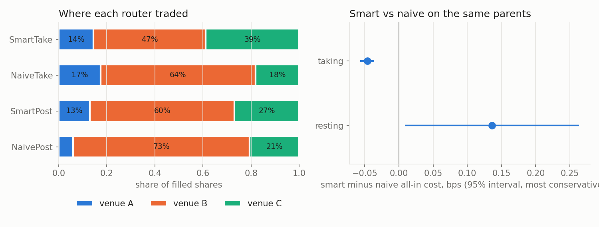

# Research

Python reads the CSVs the C++ tools write. Cells use the `# %%` percent
format: open them as notebooks (jupytext, VS Code) or run them as scripts.
Needs pandas and matplotlib.

## Queue position and latency (S6)

```
./build/fill_study day.itch fills.csv AAPL MSFT SPY QQQ TSLA
python3 research/fill_study.py fills.csv
```

`fill_study` replays the ITCH file and places virtual passive orders at the
best bid and offer. It joins in two ways:

- **Timer:** it joins every 100 ms.
- **New level:** it joins each time an order opens a new best price level.

Each decision is sent at six latencies, from 0 to 100 ms. The virtual orders
never touch the book. Each one remembers the ids of the real orders queued
ahead of it on arrival, so queue position is exact. ITCH order refs are not
monotonic, even per stock, so a ref comparison would not work. An order is
filled when either of these happens:

- An order behind it at its price executes.
- The market trades or quotes through its price.

Unfilled orders are cancelled after 10 s. See `src/analytics/fill_study.hpp`
for the exact rules.

### Data

- NASDAQ TotalView-ITCH 5.0, 2019-01-30, the first 751 MB (to about 09:38).
- 22.4 M messages, AAPL MSFT SPY QQQ TSLA.
- 433k virtual orders.
- The replay plus the study takes 0.79 s on an Apple M1 (median of 5 runs).
- This is the first eight minutes of the session, the busiest stretch, so the
  numbers describe the open, not a whole day.

### Results

**Queue position matters.** Within each symbol, the further back an order joins, the
less likely it is to fill (timer joins, 0 latency, P(fill within 1 s)):

| symbol | shortest fifth of queues | longest fifth |
|---|---|---|
| SPY | 0.74 | 0.46 |
| QQQ | 0.73 | 0.39 |
| AAPL | 0.58 | 0.39 |
| MSFT | 0.43 | 0.29 |
| TSLA | 0.13 | 0.08 |

Pooling share buckets across symbols hides this, because the symbols differ.
TSLA has short queues and a wide spread, so it rarely fills. SPY and QQQ have
long queues and fill often. Bucket within the symbol.


**Latency matters where the queue is new.** For timer joins, the queue barely
changes in 10 ms. P(fill within 1 s) only moves from 0.416 at 0 latency to
0.413 at 10 ms. Joining a freshly opened level is a race:

| latency | median queue ahead | P(fill 1 s) | 1 s markout, ticks |
|---|---|---|---|
| 0 | 100 | 0.607 | -0.42 |
| 100 us | 200 | 0.594 | -0.48 |
| 1 ms | 200 | 0.579 | -0.51 |
| 10 ms | 111 | 0.556 | -0.57 |
| 100 ms | 100 | 0.519 | -0.63 |

At 0 latency we are second in the new queue, behind the order that opened it.

- **100 us to 1 ms:** a slower order has already queued behind other
  participants.
- **10 to 100 ms:** the level has often emptied again. This happens for 26% of
  orders at 10 ms and 38% at 100 ms, so the queue looks short again. But the
  order now rests alone on a price the market has left.

**Adverse selection.** The average fill loses about 0.3 tick of mid within
1 s. It loses more as latency grows. For new-level joins the loss is 0.42 tick
at 0 latency and 0.63 tick at 100 ms. A slow passive order is filled mostly
when the market moves through it.


### Lookup table

`fill_prob.csv` is used by the S7 adaptive algo and the S8 router. It gives
P(fill within 100 ms / 1 s / 10 s) for each symbol, queue bucket and latency,
from timer joins. Each row covers `queue_lo <= shares ahead < queue_hi`; an
empty `queue_hi` means the bucket has no upper bound.

The table is a model, and S7 and S8 are scored with it, so it is fitted only
on a **training window**: decisions from 09:30:00 to 09:32:50. Its 10 s
horizon then ends before the **test window** opens at 09:33:00, and S7 and S8
are scored only on parents that start in the test window. The figures above
still describe the whole morning, because they are measurements, not inputs
to anything scored later.

```
./build/fill_study --until 09:32:50 day.itch fills_train.csv AAPL MSFT SPY QQQ TSLA
python3 research/fill_study.py fills.csv fills_train.csv     # figures from all, table from training only
```

### Limits

- **Size:** virtual orders are treated as size-negligible. The first trade
  that reaches an order fills all of it, and the order never moves the market.
- **Hidden liquidity:** hidden-order executions (ITCH `P`) are not parsed, so
  fills are slightly undercounted.
- **End of data:** orders still open when the data ends are dropped. There
  are 3.3k of them, below 1%.
- **Coverage:** the results come from one morning and five symbols.

## Execution algos and TCA (S7)

```
./build/algo_compare --from 09:33:00 day.itch research/fill_prob.csv algos.csv AAPL MSFT SPY QQQ TSLA
python3 research/algo_compare.py algos.csv
```

Six algos work the same parent orders. Each algo sends its child orders
through the OMS and the risk check, with 100 us of latency each way. The
child orders rest in the replayed books next to the real orders:

- **Resting children:** they fill when real executions reach them in the
  queue, or when the market trades through their price
  (`Venue::replay_execute`).
- **Crossing children:** they are IOCs at the far touch, and they take real
  liquidity off the book.

### The parent orders

- **Test window only.** One parent per symbol starts every 10 s from
  09:33:00 to 09:36:00, 19 starts in all, after the window the fill table was
  fitted on.
- Each parent lasts 1 minute. Buys and sells alternate.
- Each is sized at 5% of the volume in the minute before it (past data, so
  that is not look-ahead). The median is 1,800 shares.
- VWAP's volume curve comes from that same previous minute.
- In total there are 95 parents per algo.

Parents that overlap in time would trade against each other's liquidity, so
each replay runs only every sixth start: 36 replays of the 751 MB file.

### How each algo works

- Each algo works in 1 s steps.
- The new part of the schedule rests at the near touch.
- Any part already due that has not filled is crossed.
- After the end time, everything left is crossed.
- Settings:
  - POV runs at a 10% participation rate.
  - IS uses urgency kT = 2.
  - Iceberg shows about 5% of the parent at a time.
  - Adaptive follows the TWAP schedule. It crosses the whole slice when a
    hand-set score is positive. The score combines how far behind it is,
    book imbalance, S6 fill probability, spread and recent volatility.
- **The Adaptive weights were never tuned on results.** They were written in
  the commit that added the algos (`0be052f`), before `algo_compare` existed,
  and haven't changed since.

### Results (test window)

Mean cost per algo, in bps of the arrival mid. Positive is a cost. Every
parent completed, so opportunity cost is 0.

| algo | shortfall | spread | timing | vs VWAP | passive fills | children | duration |
|---|---|---|---|---|---|---|---|
| TWAP | 1.43 | 0.57 | 0.86 | 1.11 | 63% | 118 | 60 s |
| VWAP | 1.53 | 0.66 | 0.87 | 1.23 | 61% | 109 | 60 s |
| POV | 1.94 | 0.95 | 0.99 | 1.28 | 46% | 47 | 34 s |
| Iceberg | 0.79 | -0.93 | 1.72 | -0.61 | 100% | 30 | 26 s |
| IS | 1.66 | 0.61 | 1.05 | 1.33 | 62% | 125 | 60 s |
| Adaptive | 1.14 | 0.39 | 0.75 | 0.82 | 40% | 77 | 60 s |

The market's own drift over a minute is far bigger than any gap between algos.
So the useful comparison is paired: each algo minus TWAP on the same parent.

**How uncertain the paired gaps are.** The 95 parents are not 95 independent
samples. The five symbols at one start share the market, and neighbouring
starts overlap by 50 of their 60 seconds. `paired_stats.py` computes three
standard errors:

- iid, as if every parent were independent;
- clustered by start time;
- a moving-block bootstrap over runs of 6 starts.

The table uses the largest of the three, and the 95% interval is ±1.96 of
it. With 19 starts, that is still only a rough interval.

| algo | shortfall vs TWAP, bps | 95% interval | SE: iid / clustered / block |
|---|---|---|---|
| Adaptive | **-0.29** | -0.53 to -0.05 | 0.12 / 0.09 / 0.05 |
| VWAP | +0.11 | -0.19 to +0.40 | 0.15 / 0.15 / 0.10 |
| IS | +0.23 | -0.31 to +0.77 | 0.18 / 0.28 / 0.12 |
| POV | +0.52 | -0.32 to +1.35 | 0.30 / 0.43 / 0.16 |
| Iceberg | -0.64 | -1.91 to +0.63 | 0.47 / 0.65 / 0.39 |


### What the results show

- **Adaptive beats TWAP out of sample: -0.29 bps, interval -0.53 to -0.05.**
  - On the earlier in-sample run (the whole morning, with a fill table fitted
    on that same morning) it was -0.28.
  - The fill table barely moves it. Scoring the same test window with the old
    whole-morning table gives the same -0.29. So the leakage didn't create
    this result.
  - Of the gap, -0.18 is spread and -0.11 timing. Adaptive crosses more often
    than TWAP (only 40% of its fills are passive), but it chooses when:
    tight spreads, and imbalance leaning against it. So each cross is
    cheaper.
- **Iceberg's in-sample "win" doesn't hold up.** It was -1.57 bps on the
  whole morning. In the test window it is -0.64, with an interval that
  includes zero. It also depends most on the fill model, which is generous
  to resting orders, as explained under Limits.
- **IS, VWAP and POV are not distinguishable from TWAP.** Over one minute, IS
  with kT = 2 front-loads only slightly. One minute of history is a noisy
  volume curve for VWAP. POV at 10% finishes early, in 34 s, and crosses
  more.

### Limits

- **Fill model:** passive fills follow the real queue, but the real market
  never reacts to our orders. When we fill ahead of a feed order, the feed
  order still trades in full. In effect the aggressor was that much bigger.
  This flatters resting orders, which matters most for Iceberg.
- **Book drift:** our IOCs remove real orders. The feed later cancels or
  executes orders that are already gone, and the replay drops those
  messages, a few hundred per replay.
- **One morning:** the training and test windows are 3 minutes each, back
  to back, on one morning. That separates the fit from the score. It is not
  the same as testing on another day, which is the next step: the tools
  already take any ITCH file.

## Smart order routing (S8)

```
./build/sor_compare --from 09:33:00 day.itch research/fill_prob.csv sor.csv AAPL MSFT SPY QQQ TSLA
python3 research/sor_compare.py sor.csv
```

### The venues

Three venues are carved out of the one real NASDAQ book. Each real order
goes to one venue, picked by a hash of its order reference. Its executions,
cancels and replaces follow it there. So each venue holds a random slice of
the market, and together they hold all of it. A test checks that the three
books add up, level by level, to the single-venue replay.

| venue | share of orders | take fee | make fee | latency (one way) |
|---|---|---|---|---|
| A | 10% | 0.10¢ | 0.05¢ rebate | 50 us |
| B | 60% | 0.30¢ | 0.25¢ rebate | 100 us |
| C | 30% | 0.10¢ rebate (inverted) | 0.15¢ | 1 ms |

### The parent orders and modes

For each symbol, a parent starts every 5 s from 09:33:00 to 09:37:00 (the
test window, after the fill table's training window), and buys and sells
alternate. Each is sized at 1% of the previous minute's volume (median 300
shares). That gives 245 parents. Each parent runs in four modes:

- **Take:** route the whole order as IOCs, and route the remainder again once
  every child is back.
  - The smart router water-fills across venues by all-in cost per share:
    price, plus taker fee, plus `sigma * sqrt(latency)`, plus a retry cost on
    venues whose IOCs miss.
  - The naive router sends everything to the venue showing the best price.
- **Post:** rest the whole order at the best price on our side for 2 s,
  then take the rest with the smart router.
  - The smart router picks the venue with the best expected value: fill
    probability (from the S6 table, corrected online per venue) times the
    rebate and spread earned, against the cost of crossing later.
  - The naive router always rests where the rebate is biggest (B).

### Results (test window)

Paired results, smart minus naive, all-in cost in bps of the arrival mid.
Errors are the largest of iid, clustered by start time, and a block bootstrap
over 12 starts (one minute), as in S7.

| | cost | 95% interval | of which fees | other |
|---|---|---|---|---|
| taking | **-0.046** | -0.056 to -0.036 | -0.046 | done in 1.01 rounds instead of 2.24 |
| resting | +0.136 | +0.009 to +0.263 | +0.029 | 4.5 points fewer passive fills |



- **Smart taking wins, by fees alone.** The naive router looks only at
  price. B is the deepest venue, so it most often shows the best price, and
  B costs 0.30¢ to take from. The smart router takes C first at the same
  price, because C pays takers. It sends 39% of its shares to C, against 18%
  for naive. The prices paid are the same, so the whole gain is fees. The
  venues and fees are my own construction, so this shows the router does
  what it is built to do, not a market finding.
- **Smart taking finishes in one round.** It splits across venues at once.
  Naive takes one venue's touch per round, so it needs about 2.2 rounds. This
  barely matters here, because the replayed quotes rarely vanish within a
  round trip.
- **Smart resting loses to rebate chasing.** It is 0.14 bps worse.
  - The S6 fill table was measured on one consolidated book, where every
    aggressor reaches the front of the queue. In this replay, a real
    aggressor only trades on the venue that held its order in the feed. So a
    thin venue (A) gets few fills even when its queue is short, and the
    table, read as queue / flow share, is far too optimistic there.
  - Fitting the table on the training window made smart resting look worse,
    not better: +0.136, against +0.103 when the test window is scored with
    the old whole-morning table. The leak had flattered it by about 0.03 bps.

### What this shows

- **The router can only be as good as its fill model.** A SOR's passive
  routing depends on a fill model calibrated per venue.
- **The simulator decides who wins.** In this simulator, the deepest venue
  wins by construction. On real markets, other routers send aggressive flow
  to whichever venue is alone at the best price. That model, where taking
  flow is rerouted to the best price, is the next thing to add before
  trusting any passive routing result.

### Limits

- **Fees:** they are typical US equity levels, not any one exchange's
  schedule.
- **Market data delay:** the router reads all three books instantly. Only
  orders pay latency. Quote fading and latency arbitrage are not modeled.
- **Coverage:** one morning and five symbols. There are 245 parents per
  mode in the test window, each run as 1 replay per mode over 3 venues.
