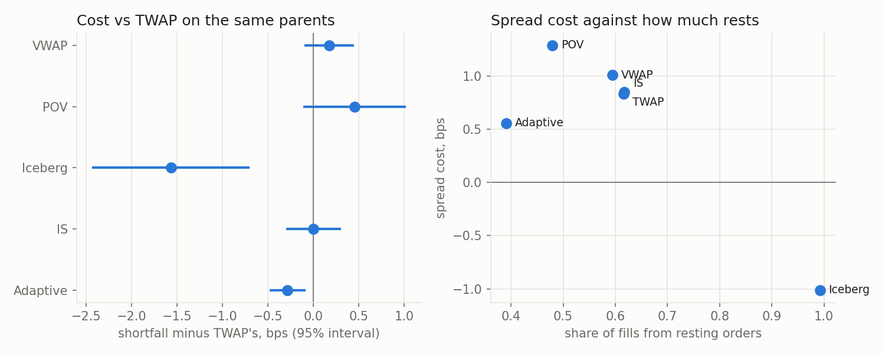

# Research

Python reads the CSVs the C++ tools write. Cells use the `# %%` percent
format: open them as notebooks (jupytext, VS Code) or run them as scripts.
Needs pandas and matplotlib.

## Queue position and latency (S6)

```
./build/fill_study 01302019.NASDAQ_ITCH50 fills.csv AAPL MSFT SPY QQQ TSLA
python3 research/fill_study.py fills.csv
```

`fill_study` replays the ITCH file and places virtual passive orders at the
best bid and offer. It joins in two ways:

- **Timer:** it joins every 100 ms.
- **New level:** it joins each time an order opens a new best price level.

Each decision is sent at six latencies, from 0 to 100 ms. The virtual orders
never touch the book. Each one remembers the ids of the real orders queued
ahead of it on arrival, so queue position is exact. ITCH order refs are not
monotonic, even per stock, so a ref comparison would not work. An order is
filled when either of these happens:

- An order behind it at its price executes.
- The market trades or quotes through its price.

Unfilled orders are cancelled after 10 s. See `src/analytics/fill_study.hpp`
for the exact rules.

### Data

- NASDAQ TotalView-ITCH 5.0, 2019-01-30, the first 751 MB (to about 09:38).
- 22.4 M messages, AAPL MSFT SPY QQQ TSLA.
- 433k virtual orders.
- The replay plus the study takes 0.79 s on an Apple M1 (median of 5 runs).
- This is the first eight minutes of the session, the busiest stretch, so the
  numbers describe the open, not a whole day.

### Results

**Queue position matters.** Within each symbol, the further back an order joins, the
less likely it is to fill (timer joins, 0 latency, P(fill within 1 s)):

| symbol | shortest fifth of queues | longest fifth |
|---|---|---|
| SPY | 0.74 | 0.46 |
| QQQ | 0.73 | 0.39 |
| AAPL | 0.58 | 0.39 |
| MSFT | 0.43 | 0.29 |
| TSLA | 0.13 | 0.08 |

Pooling share buckets across symbols hides this, because the symbols differ.
TSLA has short queues and a wide spread, so it rarely fills. SPY and QQQ have
long queues and fill often. Bucket within the symbol.


**Latency matters where the queue is new.** For timer joins, the queue barely
changes in 10 ms. P(fill within 1 s) only moves from 0.416 at 0 latency to
0.413 at 10 ms. Joining a freshly opened level is a race:

| latency | median queue ahead | P(fill 1 s) | 1 s markout, ticks |
|---|---|---|---|
| 0 | 100 | 0.607 | -0.42 |
| 100 us | 200 | 0.594 | -0.48 |
| 1 ms | 200 | 0.579 | -0.51 |
| 10 ms | 111 | 0.556 | -0.57 |
| 100 ms | 100 | 0.519 | -0.63 |

At 0 latency we are second in the new queue, behind the order that opened it.

- **100 us to 1 ms:** a slower order has already queued behind other
  participants.
- **10 to 100 ms:** the level has often emptied again. This happens for 26% of
  orders at 10 ms and 38% at 100 ms, so the queue looks short again. But the
  order now rests alone on a price the market has left.

**Adverse selection.** The average fill loses about 0.3 tick of mid within
1 s. It loses more as latency grows. For new-level joins the loss is 0.42 tick
at 0 latency and 0.63 tick at 100 ms. A slow passive order is filled mostly
when the market moves through it.


### Lookup table

`fill_prob.csv` is used by the S7 adaptive algo and the S8 router. It gives
P(fill within 100 ms / 1 s / 10 s) for each symbol, queue bucket and latency,
from timer joins. Each row covers `queue_lo <= shares ahead < queue_hi`; an
empty `queue_hi` means the bucket has no upper bound.

### Limits

- **Size:** virtual orders are treated as size-negligible. The first trade
  that reaches an order fills all of it, and the order never moves the market.
- **Hidden liquidity:** hidden-order executions (ITCH `P`) are not parsed, so
  fills are slightly undercounted.
- **End of data:** orders still open when the data ends are dropped. There
  are 3.3k of them, below 1%.
- **Coverage:** the results come from one morning and five symbols.

## Execution algos and TCA (S7)

```
./build/algo_compare 01302019.NASDAQ_ITCH50 research/fill_prob.csv algos.csv AAPL MSFT SPY QQQ TSLA
python3 research/algo_compare.py algos.csv
```

Six algos work the same parent orders. Each algo sends its child orders
through the OMS and the risk check, with 100 us of latency each way. The
child orders rest in the replayed books next to the real orders:

- **Resting children:** they fill when real executions reach them in the
  queue, or when the market trades through their price
  (`Venue::replay_execute`).
- **Crossing children:** they are IOCs at the far touch, and they take real
  liquidity off the book.

### The parent orders

- One parent per symbol starts every 10 s from 09:30:30 to 09:36:00, 34
  starts in all.
- Each parent lasts 1 minute. Buys and sells alternate.
- Each is sized at 5% of the volume in the minute before it. The median is
  2,100 shares.
- VWAP's volume curve comes from that same previous minute, so nothing looks
  ahead.
- In total there are 170 parents per algo.

Parents that overlap in time would trade against each other's liquidity, so
each replay runs only every sixth start. That takes 36 replays of the 751 MB
file, in 14.7 s.

### How each algo works

- Each algo works in 1 s steps.
- The new part of the schedule rests at the near touch.
- Any part already due that has not filled is crossed.
- After the end time, everything left is crossed.
- Settings:
  - POV runs at a 10% participation rate.
  - IS uses urgency kT = 2.
  - Iceberg shows about 5% of the parent at a time.
  - Adaptive follows the TWAP schedule. It crosses the whole slice when a
    hand-set score is positive. The score combines how far behind it is,
    book imbalance, S6 fill probability, spread and recent volatility.

### Results

Mean cost per algo, in bps of the arrival mid. Positive is a cost. Every
parent completed, so opportunity cost is 0.

| algo | shortfall | spread | timing | vs VWAP | passive fills | children | duration |
|---|---|---|---|---|---|---|---|
| TWAP | 1.12 | 0.83 | 0.29 | 1.42 | 62% | 121 | 60 s |
| VWAP | 1.29 | 1.01 | 0.28 | 1.56 | 59% | 109 | 60 s |
| POV | 1.57 | 1.29 | 0.28 | 1.77 | 48% | 50 | 36 s |
| Iceberg | -0.45 | -1.01 | 0.56 | -0.75 | 99% | 31 | 29 s |
| IS | 1.12 | 0.85 | 0.27 | 1.39 | 62% | 127 | 60 s |
| Adaptive | 0.84 | 0.56 | 0.28 | 1.10 | 39% | 77 | 60 s |

The market's own drift over a minute is about 9 bps (the standard deviation
of shortfall). That is far bigger than any gap between algos. So the useful
comparison is paired: each algo minus TWAP on the same parent.

| algo | shortfall vs TWAP, bps |
|---|---|
| Iceberg | -1.57 ± 0.44 |
| Adaptive | -0.28 ± 0.10 |
| IS | 0.00 ± 0.15 |
| VWAP | +0.17 ± 0.14 |
| POV | +0.45 ± 0.29 |



### What the results show

- **Adaptive beats TWAP by 0.28 bps (about 3 standard errors).** All of the
  gain is in spread cost. The timing difference with TWAP is -0.01 ± 0.08 bps.
  TWAP crosses whenever it falls behind, whatever the book looks like.
  Adaptive crosses more often (only 39% of its fills are passive), but it
  chooses when: tight spreads, and imbalance leaning against it. So each
  cross is cheaper.
- **Iceberg is cheapest in this model.** Almost every fill is passive, and
  it earns about 1 bp of spread. Treat this as an upper bound. Iceberg
  depends most on the fill model, which is generous to resting orders, as
  explained under Limits.
- **IS and VWAP match TWAP.** Over one minute, IS with kT = 2 front-loads
  only slightly. One minute of history is a noisy volume curve for VWAP.
- **POV is the most expensive.** At 10% participation it finishes early,
  in 36 s, and crosses more.
- **Prices revert after we stop.** The mid comes back about 1.2 bps within
  10 s of the end for the schedule algos. That is temporary impact, mostly
  from the final crossing.

### Limits

- **Fill model:** passive fills follow the real queue, but the real market
  never reacts to our orders. When we fill ahead of a feed order, the feed
  order still trades in full. In effect the aggressor was that much bigger.
  This flatters resting orders, which matters most for Iceberg. 5% of the
  flow is small, but not zero.
- **Book drift:** our IOCs remove real orders. The feed later cancels or
  executes orders that are already gone, and the replay drops those
  messages: 340 to 510 per replay, against 725k messages for these symbols.
- **Adaptive weights:** they are hand-set, not fitted. Fitting them on one
  morning and testing on the same morning would overfit. That needs more
  days of data.
- **Coverage:** one morning, five symbols, and 1-minute parents.
