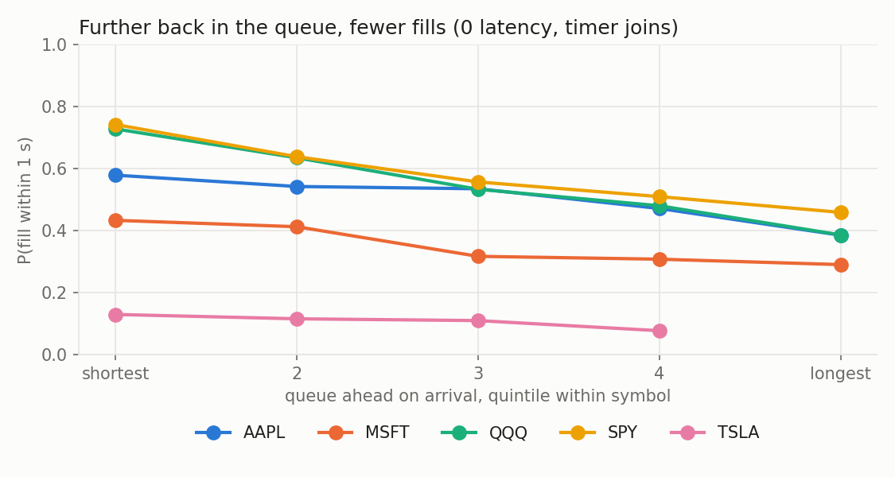
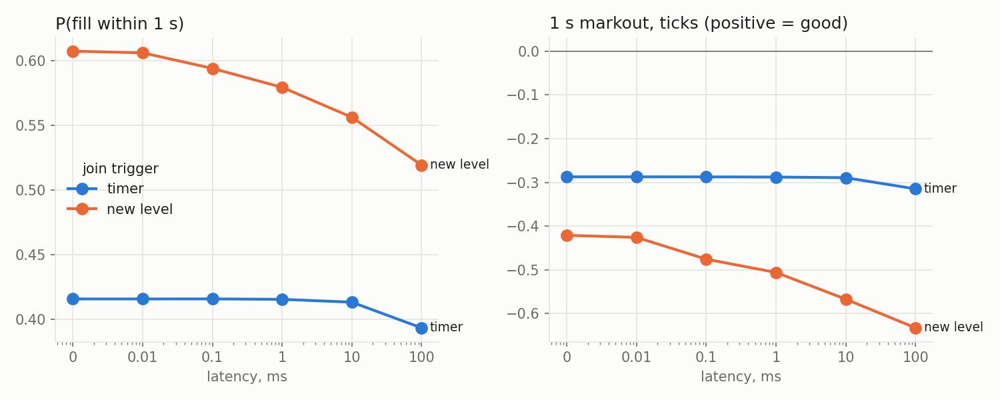

# Research

Python reads the CSVs the C++ tools write. Cells use the `# %%` percent
format: open them as notebooks (jupytext, VS Code) or run them as scripts.
Needs pandas and matplotlib.

## Queue position and latency (S6)

```
./build/fill_study 01302019.NASDAQ_ITCH50 fills.csv AAPL MSFT SPY QQQ TSLA
python3 research/fill_study.py fills.csv
```

`fill_study` replays the ITCH file and places virtual passive orders at the
best bid and offer. It joins in two ways:

- **Timer:** it joins every 100 ms.
- **New level:** it joins each time an order opens a new best price level.

Each decision is sent at six latencies, from 0 to 100 ms. The virtual orders
never touch the book. Each one remembers the ids of the real orders queued
ahead of it on arrival, so queue position is exact. ITCH order refs are not
monotonic, even per stock, so a ref comparison would not work. An order is
filled when either of these happens:

- An order behind it at its price executes.
- The market trades or quotes through its price.

Unfilled orders are cancelled after 10 s. See `src/analytics/fill_study.hpp`
for the exact rules.

### Data

- NASDAQ TotalView-ITCH 5.0, 2019-01-30, the first 751 MB (to about 09:38).
- 22.4 M messages, AAPL MSFT SPY QQQ TSLA.
- 433k virtual orders.
- The replay plus the study takes 0.96 s on an M-series laptop.
- This is the first eight minutes of the session, the busiest stretch, so the
  numbers describe the open, not a whole day.

### Results

**Queue position matters.** Within each symbol, the further back an order joins, the
less likely it is to fill (timer joins, 0 latency, P(fill within 1 s)):

| symbol | shortest fifth of queues | longest fifth |
|---|---|---|
| SPY | 0.74 | 0.46 |
| QQQ | 0.73 | 0.39 |
| AAPL | 0.58 | 0.39 |
| MSFT | 0.43 | 0.29 |
| TSLA | 0.13 | 0.08 |

Pooling share buckets across symbols hides this, because the symbols differ.
TSLA has short queues and a wide spread, so it rarely fills. SPY and QQQ have
long queues and fill often. Bucket within the symbol.



**Latency matters where the queue is new.** For timer joins, the queue barely
changes in 10 ms. P(fill within 1 s) only moves from 0.416 at 0 latency to
0.413 at 10 ms. Joining a freshly opened level is a race:

| latency | median queue ahead | P(fill 1 s) | 1 s markout, ticks |
|---|---|---|---|
| 0 | 100 | 0.607 | -0.42 |
| 100 us | 200 | 0.594 | -0.48 |
| 1 ms | 200 | 0.579 | -0.51 |
| 10 ms | 111 | 0.556 | -0.57 |
| 100 ms | 100 | 0.519 | -0.63 |

At 0 latency we are second in the new queue, behind the order that opened it.

- **100 us to 1 ms:** a slower order has already queued behind other
  participants.
- **10 to 100 ms:** the level has often emptied again. This happens for 26% of
  orders at 10 ms and 38% at 100 ms, so the queue looks short again. But the
  order now rests alone on a price the market has left.

**Adverse selection.** The average fill loses about 0.3 tick of mid within
1 s. It loses more as latency grows. For new-level joins the loss is 0.42 tick
at 0 latency and 0.63 tick at 100 ms. A slow passive order is filled mostly
when the market moves through it.



### Lookup table

`fill_prob.csv` is used by the S7 adaptive algo and the S8 router. It gives
P(fill within 100 ms / 1 s / 10 s) for each symbol, queue bucket and latency,
from timer joins. Each row covers `queue_lo <= shares ahead < queue_hi`; an
empty `queue_hi` means the bucket has no upper bound.

### Limits

- **Size:** virtual orders are treated as size-negligible. The first trade
  that reaches an order fills all of it, and the order never moves the market.
- **Hidden liquidity:** hidden-order executions (ITCH `P`) are not parsed, so
  fills are slightly undercounted.
- **End of data:** orders still open when the data ends are dropped. There
  are 3.3k of them, below 1%.
- **Coverage:** the results come from one morning and five symbols.
